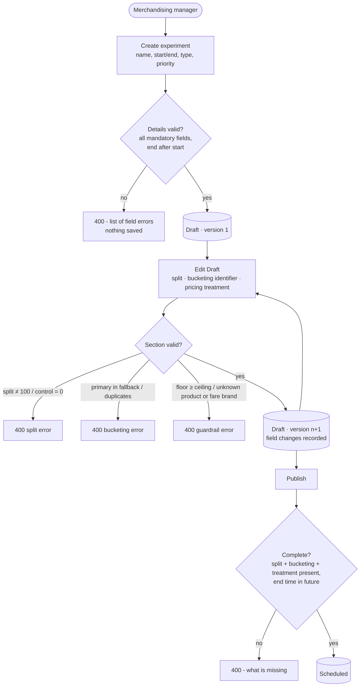
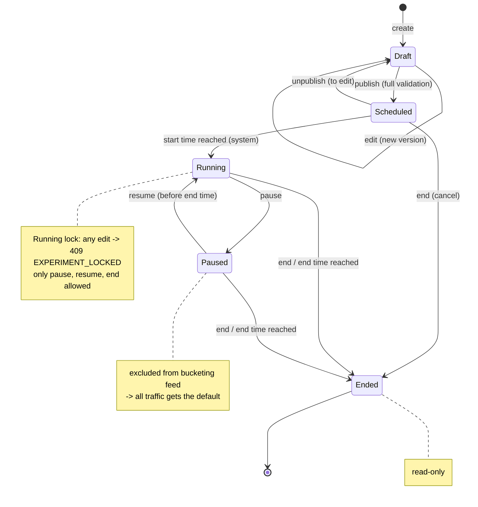
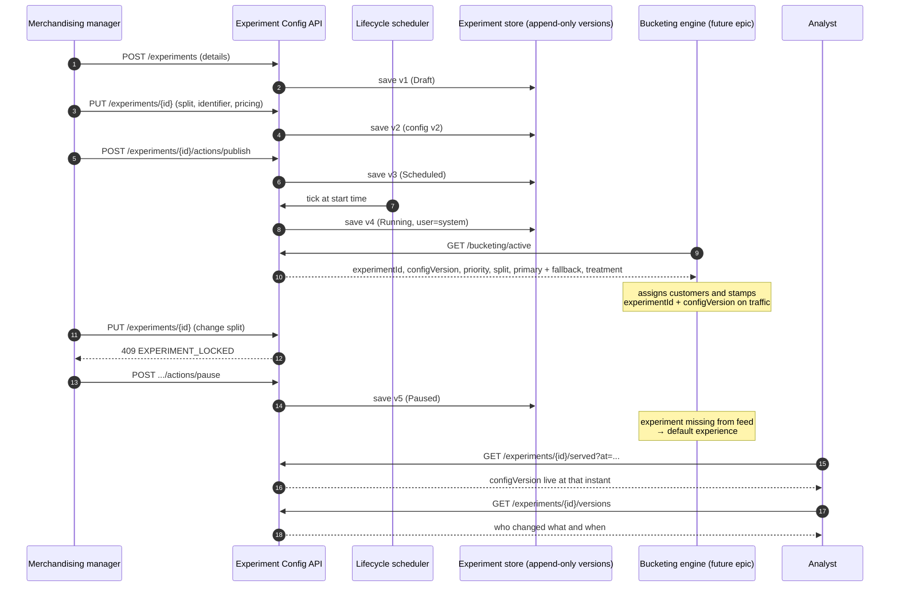

# Flow diagrams

`experiment-flow.svg` (next to this file) is a single picture that can be attached to the Jira epic. The Mermaid sources below show the same flows in more detail. They render on GitHub, GitLab and in Confluence with the Mermaid macro.

## 1. Configuration flow (Draft)

## 2. Lifecycle state machine

## 3. Hand-off to the bucketing engine and traceability

